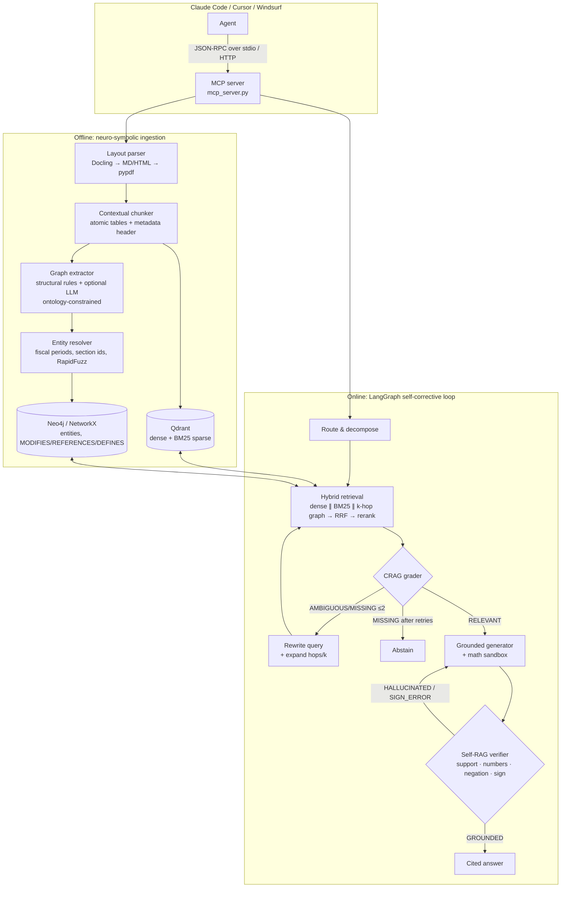

# Self-Corrective GraphRAG: an MCP server for document reading

**Layout-aware, graph-linked, self-verifying document retrieval. Works in Claude Code, Codex, Cursor, VS Code, Antigravity, Windsurf, Claude Desktop and any other MCP client, or straight from your terminal with no agent at all.**

Coding agents handle source code well but struggle with long reference documents: 300-page API specs, hardware datasheets, compliance manuals, 10-K filings. If an agent reads the PDF directly, it floods its context window, breaks tables apart, misses an override that sits 120 pages after the default it changes, and fills gaps with guesses. This server is built to fix each of those problems.

| What happens when an agent reads the PDF itself | What happens with `graphrag-reader` |
|---|---|
| Tens of thousands of raw tokens go into context, and facts in the middle get lost | About 5 verified chunks come back (roughly 800 tokens), with page citations |
| Multi-column pages get interleaved and table headers get cut off from their rows | Docling reads columns in the right order, tables stay whole, and units like "(in millions)" stay attached |
| A default in §2 and its override in Appendix B never show up together | A knowledge graph links them (`Appendix B -[MODIFIES]-> Section 2`), so both are retrieved |
| If the document is silent, the model guesses | Evidence is graded first (CRAG). If nothing supports an answer, the tool **abstains** |
| The model does arithmetic in its head and misreads `(0.3)` as positive | All math runs in a deterministic sandbox, and the verifier catches flipped signs and negations |

---

## Quick start

### One-line install (recommended)

**Windows** (PowerShell):

```powershell
irm https://raw.githubusercontent.com/sindhu-krish/RAG/main/install.ps1 | iex
```

**macOS / Linux:**

```bash
curl -LsSf https://raw.githubusercontent.com/sindhu-krish/RAG/main/install.sh | sh
```

The script does the whole setup in one go:
- Installs **uv** if it is missing. uv also installs Python 3.11+ itself, so Python doesn't need to be installed first.
- Reloads PATH in the same window, so you don't need to open a new terminal.
- Clones the repo into `~/RAG`. If **Git is not installed**, it downloads the ZIP instead.
- Runs `uv sync` and then a self-test (`graphrag doctor`).
- Registers the MCP server with every agent or IDE it finds: Claude Code, Codex, Cursor, VS Code, Antigravity, Windsurf and Claude Desktop.

Running it again updates an existing install. Afterwards, **restart your agent/IDE**.

Options (set before running): `GRAPHRAG_CLIENTS=codex,cursor` (or `none`) and `GRAPHRAG_HOME=<folder>`.
In PowerShell, use `$env:GRAPHRAG_CLIENTS="codex"`.

**Using an agent?** Just tell it *"install https://github.com/sindhu-krish/RAG"*. The repo's `AGENTS.md` (and `CLAUDE.md` / `GEMINI.md`) gives Codex, Claude Code, Cursor, Copilot and Antigravity the exact steps.

### Manual install

Run one command per line (Windows PowerShell 5.1 does not accept `&&`):

```
git clone https://github.com/sindhu-krish/RAG.git
cd RAG
uv sync
uv run graphrag doctor
```

| Problem | Fix |
|---|---|
| `git` / `uv` "is not recognized" **right after installing it** | The window still has the old PATH. Open a **new** terminal, or run `$env:Path = [Environment]::GetEnvironmentVariable("Path","Machine") + ";" + [Environment]::GetEnvironmentVariable("Path","User")` |
| `git` not installed | `winget install --id Git.Git -e`, or skip Git: on GitHub click **Code → Download ZIP**, extract it, `cd` into the folder |
| `uv` not installed | `winget install --id astral-sh.uv -e` (Windows) or `curl -LsSf https://astral.sh/uv/install.sh \| sh` |
| `cd RAG` fails | The clone failed. Fix git first, or use the one-line installer |
| Agent shows no `graphrag-reader` tools | Restart the agent/IDE. Run `uv run graphrag doctor` to see which configs contain it |

You can then use it in either of two ways.

### Option A: plug it into your coding agent or IDE (one command)

```bash
uv run graphrag install all            # every agent/IDE detected (the one-line installer already did this)
# or pick one:
uv run graphrag install claude-code
uv run graphrag install codex
uv run graphrag install cursor
uv run graphrag install vscode
uv run graphrag install antigravity
uv run graphrag install windsurf
uv run graphrag install claude-desktop
```

The installer writes the correct config with this repo's absolute path, merges it into any existing config without touching your other servers, and keeps a `.bak` copy of the old file. Useful flags:

| Flag | Effect |
|---|---|
| `--scope project --project-dir .` | Writes a per-project config to commit for your team (`.mcp.json`, `.cursor/mcp.json`, `.vscode/mcp.json`, `.codex/config.toml`, `.agents/mcp_config.json`) |
| `--print` | Shows what would be written and changes nothing |
| `--print-all` | Prints copy-paste config for every client |
| `--uninstall` | Removes the server again |

Restart the client (or reload its MCP servers) afterwards. Per-client details:

| Client | What `graphrag install` does | Manual setup |
|---|---|---|
| **Claude Code** | runs `claude mcp add --scope user graphrag-reader -- uv run --directory <repo> mcp_server.py` | same command; project scope writes `.mcp.json` |
| **Codex** (CLI, IDE extension and desktop app share one config) | adds `[mcp_servers.graphrag-reader]` to `~/.codex/config.toml`, with `tool_timeout_sec = 900` so long ingests don't time out | `codex mcp add graphrag-reader -- uv run --directory <repo> mcp_server.py`. Project `.codex/config.toml` only loads in trusted projects |
| **Cursor** | merges into `~/.cursor/mcp.json` | `integrations/cursor.mcp.json` |
| **VS Code** (GitHub Copilot agent mode) | runs `code --add-mcp '{…"type":"stdio"…}'`; project scope writes `.vscode/mcp.json` | VS Code uses a top-level **`servers`** key and needs `"type": "stdio"`. See `integrations/vscode.mcp.json`. Use the tools in **Agent** mode |
| **Antigravity** (IDE, CLI and app) | merges into `~/.gemini/config/mcp_config.json` (and the legacy `~/.gemini/antigravity/mcp_config.json` if present) | Agent panel → `…` → MCP Servers → Manage → View raw config. Project scope: `.agents/mcp_config.json`. Remote servers use `serverUrl`, not `url` |
| **Windsurf** | merges into `~/.codeium/windsurf/mcp_config.json` | `integrations/windsurf.mcp_config.json` |
| **Claude Desktop** | merges into the OS-specific `claude_desktop_config.json` | `integrations/claude-desktop.json` |
| **Any other MCP client** | | stdio command: `uv run --directory <repo> mcp_server.py` |

Then just ask your agent something like:

> *"Ingest `docs/gateway-spec.pdf` and `docs/q3-compliance.pdf`, then update `config/rate_limits.py` to match the Enterprise rate-limit tables."*

The agent calls `ingest_complex_doc` once per file, then `ask_verified_docs` / `extract_verified_table` as it works.

**Shared or remote server:** run `uv run graphrag serve --http --host 0.0.0.0 --port 8765`, then point clients at `http://host:8765/mcp` (Claude Code: `claude mcp add --transport http graphrag-reader <url>`; Codex: `codex mcp add graphrag-reader --url <url>`; Antigravity: `"serverUrl": "<url>"`).

### Option B: use it straight from the terminal (no agent needed)

The same engine, with the same verified, cited answers:

```bash
uv run graphrag ingest docs/gateway-spec.pdf --domain technical
uv run graphrag ingest filings/*.pdf --domain finance

uv run graphrag ask "What is max_requests_per_minute for Enterprise keys?"
uv run graphrag ask "Net income in FY2024?" --doc amd_10k_2024 --json
uv run graphrag trace max_requests_per_minute --hops 2
uv run graphrag table "operating metrics" --compute "pct_change(1,840, 2,310)"
uv run graphrag docs
uv run graphrag doctor                 # self-test

uv run graphrag chat                   # interactive session
#   graphrag> What is the default burst_size?
#   graphrag> :trace Appendix B
#   graphrag> :table default limits by endpoint
#   graphrag> :doc gateway-spec        (restrict to one document; ":doc *" clears it)
#   graphrag> :quit
```

Add `--plain` to strip Markdown. To use `graphrag` without the `uv run` prefix, install it as a tool: `uv tool install .` (or `pipx install .`). Without uv, run `python graphrag_cli.py <command>` from the clone after installing the dependencies.

The terminal and every MCP client share one index (`~/.graphrag-mcp`, or set `GRAPHRAG_DATA_DIR`), so a document ingested in one is available in all the others.

## Tools

| Tool | What it does |
|---|---|
| `ingest_complex_doc(file_path, domain_tag, doc_name?, force?)` | Parses the layout, splits the document into chunks with context, extracts entities and relations into the graph using a fixed ontology, and builds the dense and BM25 indexes. Running it again on an unchanged file does nothing. |
| `ask_verified_docs(query, doc_filter?, response_format?, verbose?)` | Runs the full self-corrective loop and returns an answer with `[E#]` citations and a status: `verified`, `partially_verified` or `abstained`. The output is compact by default (about 200 tokens); `verbose=true` adds chunk ids and the loop trace. |
| `trace_entity_relations(entity_name, max_hops, doc_filter?)` | Walks the graph out from a parameter, component, metric or section. Shows where it is defined, what references or overrides it, and cites every edge. |
| `extract_verified_table(topic, doc_name?, compute?)` | Returns the exact table as Markdown, with units and parenthetical negatives kept. Optional sandboxed arithmetic checks that every operand appears in the table. |
| `list_indexed_docs()` | Lists the indexed documents, the graph size, and which backends are active. |

## Architecture



### Design choices that matter

- **Cross-store foreign keys.** Each Qdrant payload stores `entity_ids`, and each graph node stores `chunk_ids`. That is how the graph leg and the vector leg feed into the same RRF ranking.
- **Graph seeds come from two places:** entities named in the query, and the section nodes of the top vector hits. So a question that never mentions "Enterprise" still reaches Appendix B's override through `Section 2 ←MODIFIES─ Appendix B`.
- **Override evidence is always included.** If a retrieved section is modified by another section, that modifying section is added to the evidence even when the reranker scored it low. Leaving out an override is the most damaging mistake a spec-QA system can make.
- **The ontology is fixed** per `domain_tag` (`technical`, `finance`, `legal`, `general`). Any LLM output with types outside it is dropped. Section IDs are scoped to their document, while parameters and metrics are shared, so documents link to each other through them.
- **Verification is mostly deterministic.** Every cited claim must overlap lexically with its source. Every number must appear in the cited chunk or come from the sandbox. A negation is checked against the best-matching source sentence. A `(x)` in the source shown as a positive value is flagged `SIGN_ERROR`. An internal LLM, if configured, adds a semantic check on top. It never replaces these checks.
- **The sandbox does not use `eval`.** It interprets an AST whitelist (numbers, operators, `pct_change`, `cagr`, `round`, …) with bounded exponents and magnitudes.

## Lite mode vs full mode

Every component works without its optional dependency and upgrades automatically once that dependency is installed:

| Component | Lite (default, zero setup) | Full |
|---|---|---|
| PDF parsing | pypdf (warns: no table structure) | `uv sync --extra docling` → Docling layout model |
| Dense embeddings | offline hashed n-gram embedder | `--extra embeddings` → fastembed `bge-small` (or set `GRAPHRAG_DENSE_MODEL=BAAI/bge-large-en-v1.5`) |
| Sparse | BM25 (Qdrant IDF modifier) | same |
| Reranker | lexical precision scorer | `--extra rerank` → `BAAI/bge-reranker-v2-m3` cross-encoder |
| Vector store | embedded Qdrant on disk | `docker compose up -d` + `QDRANT_URL` |
| Graph store | NetworkX + Louvain communities, saved as JSON | `NEO4J_URI` (Neo4j 5 / Memgraph) |
| LLM steps | deterministic: extractive answers, heuristic grading | `ANTHROPIC_API_KEY` or `OPENAI_API_KEY` (+ `OPENAI_BASE_URL` for Gemini/Ollama/vLLM) |

**No API key is needed when running inside Claude Code.** In lite or no-LLM mode the server returns *extractive*, cited, verified evidence, and Claude, as the host model, writes the prose. Adding an internal LLM makes extraction, decomposition and grading sharper, and lets the server compute answers through `<calc>` sandbox calls.

Full install: `uv sync --extra all` (Docling pulls in PyTorch, so it is large).

## Benchmarking (ablation)

```bash
uv sync --extra eval
# FinanceBench: save filings as data/raw_docs/<doc_name>.pdf
uv run python evaluation/run_benchmark.py --dataset financebench --limit 150 --out results.json
# or your own questions
uv run python evaluation/run_benchmark.py --dataset jsonl --questions evaluation/sample_questions.jsonl
```

It runs three configurations: **naive** (dense only), **hybrid** (dense + BM25 + RRF + rerank, no graph, no loop) and **full**. It reports Context Recall@5, Numeric Accuracy, Abstain Rate, and p50/p95 latency. The bundled fixture is far too small to separate the three, so use FinanceBench, HotpotQA or LegalBench-RAG for numbers you plan to report.

## Repository layout

```
RAG/
├── mcp_server.py                 # MCP entry point (uv run --directory … mcp_server.py)
├── graphrag_cli.py               # terminal entry point without installing (python graphrag_cli.py ask …)
├── install.ps1 / install.sh      # one-line installers (uv, code, deps, self-test, agent registration)
├── AGENTS.md (+ CLAUDE.md, GEMINI.md)  # setup/usage instructions read by coding agents
├── integrations/                 # manual configs: Claude Code, Codex, Cursor, VS Code, Antigravity, Windsurf, Claude Desktop
├── src/graphrag/
│   ├── server.py                 # MCPServer + 5 tools, markdown rendering
│   ├── cli.py                    # `graphrag` command: ingest / ask / trace / table / chat / serve / install
│   ├── installer.py              # writes/merges MCP config for every supported client
│   ├── engine.py                 # facade: ingest / ask / trace / table
│   ├── config.py  models.py  llm.py
│   ├── ingestion/  layout_parser.py  chunker.py  graph_extractor.py  entity_resolver.py
│   ├── indexing/   embeddings.py  qdrant_store.py  graph_store.py
│   ├── retrieval/  hybrid.py  reranker.py
│   └── agent/      state.py  nodes.py  sandbox.py  workflow.py
├── evaluation/run_benchmark.py   # naive vs hybrid vs full ablation
├── tests/                        # unit, pipeline, stub-LLM, MCP-over-stdio, CLI and installer tests
└── docker-compose.yml            # Qdrant + Neo4j (optional)
```

## Development

```
uv sync --extra dev
uv run pytest -q
```

`tests/test_mcp_stdio.py` starts the server as a subprocess and drives it with the official MCP client, the same way Claude Code does.

**SDK note:** this targets the **MCP Python SDK 2.x**, where `FastMCP` was renamed `MCPServer` (`from mcp.server.mcpserver import MCPServer`). Code written for 1.x with `from mcp.server.fastmcp import FastMCP` fails on a fresh install.

## Known limitations

- The Neo4j store is written against the official driver but is not covered by CI (CI uses the NetworkX store). Community detection runs only on NetworkX. On Neo4j, use GDS `gds.leiden.write`.
- The structural extractor is tuned for documents with numbered sections and appendices. For prose-heavy documents, configure an LLM so it extracts richer entities.
- Without Docling, PDF tables come out as plain text lines.

MIT licensed.
